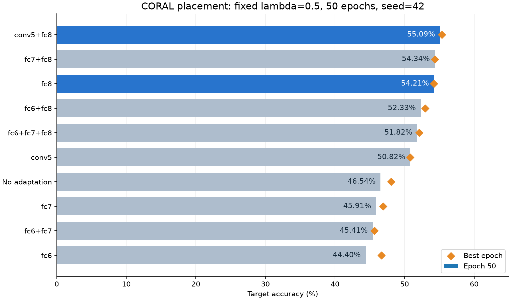
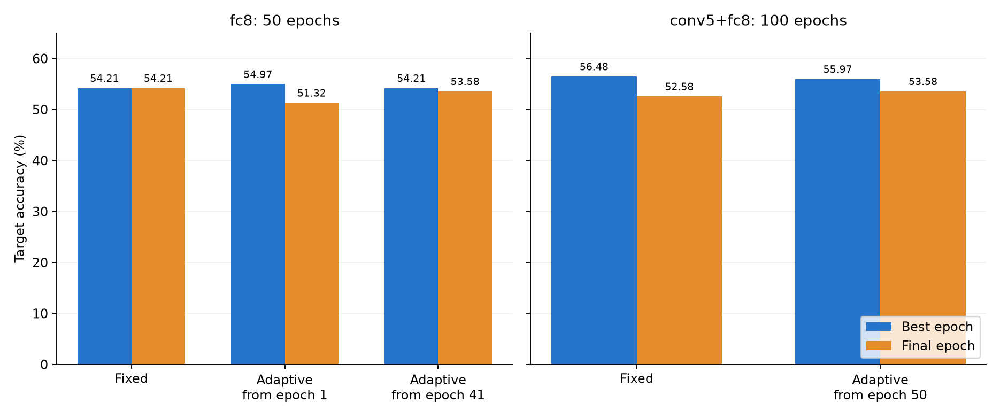
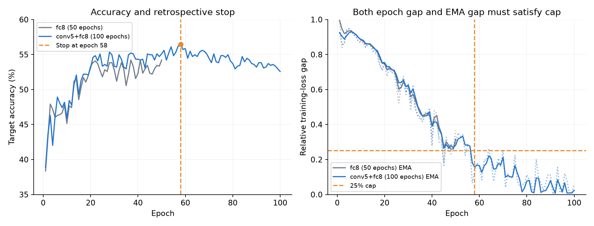

# Deep CORAL 实验简报：层位置、权重学习与早停

日期：2026-10-08。数据来自已完成的 seed=42 实验，本次整理未重跑训练。

**目前优先采用固定 λ=0.5 的 fc8 与 conv5+fc8。** 50 轮比较中，conv5+fc8 的最终准确率最高，为 55.09%；延长至 100 轮后，第 58 轮达到 56.48%，随后回落。自适应 λ 没有持续改善结果。按训练损失差值不超过 25%、连续两轮满足条件的规则回放，固定 conv5+fc8 恰好在第 58 轮触发早停。

## 1. 实验设置与统计口径

Office-31 Amazon → Webcam，源域 2,817 张、目标域 795 张；使用 ImageNet 预训练 AlexNet，fc8 输出 31 类。所有随机种子为 42，数据集保留原始图片格式。batch size=128，每轮配对训练六步；SGD 基础学习率 0.001，fc8 学习率 0.01，momentum=0.9，weight decay=0.0005。采用确定性计算并禁用 TF32。

训练目标为 $L=L_{class}+\lambda L_{CORAL}$。多层组的 $L_{CORAL}$ 是所选层损失的**均值**，共用一个 λ，因此固定 λ=0.5 的双层组中，每层实际系数为 0.25。FC 对齐使用 Linear 的 ReLU 前输出；conv5 使用空间位置上的通道协方差。原始 no_adaptation、fc8 归档由其他实验共享。

准确率均按完整目标域计算。层实验以第 50 轮排名，同时列出最佳轮次；自适应与延长训练实验同时比较最佳和最终结果。最佳值并列时取最早轮次，保留该轮评估数据。目标标签参与评估及历史结果选择，不参与损失反向传播或早停判定。表中差值单位为百分点。

## 2. 不同层的 CORAL 实验

| 对齐层 | 第 50 轮准确率 | 正确数 / 795 | 最佳准确率 | 最佳 epoch |
|---|---:|---:|---:|---:|
| conv5+fc8 | **55.09%** | 438 | 55.35% | 28 |
| fc7+fc8 | 54.34% | 432 | 54.34% | 45 |
| fc8 | 54.21% | 431 | 54.21% | 37 |
| fc6+fc8 | 52.33% | 416 | 52.96% | 33 |
| fc6+fc7+fc8 | 51.82% | 412 | 52.08% | 33 |
| conv5 | 50.82% | 404 | 50.82% | 33 |
| 不加 CORAL | 46.54% | 370 | 48.05% | 3 |
| fc7 | 45.91% | 365 | 46.92% | 45 |
| fc6+fc7 | 45.41% | 361 | 45.66% | 14 |
| fc6 | 44.40% | 353 | 46.67% | 22 |

conv5+fc8 比无对齐组提高 **8.55** 个百分点，比纯 fc8 提高 **0.88** 个百分点（多正确 7 张）；fc7+fc8 比纯 fc8 仅多正确 1 张。增加对齐层数没有带来一致收益。

一种解释是：fc8 的 31 维输出直接对应分类任务，而 fc6/fc7 的 4,096 维特征包含更多域特有变化；batch=128 时，后者样本协方差的秩最多为 127。训练中的 Dropout 又会改变 batch 特征统计。conv5 的局部通道统计与 fc8 的类别输出可能形成互补，但多层均值同时改变了每层权重。更小的对齐维数和更低的 CORAL 数值本身都不能代表更好的分类；应以准确率判断组合收益，并在同一层内比较距离。数据见 [层实验汇总](data/layer_results.csv)。

## 3. adaptive_lambda 与延长训练

自适应组以 λ=0.5 起步，在共享 conv5 参数上计算两项损失的梯度范数，用 EMA（decay=0.9）平滑，并通过独立 Adam（学习率 0.01）优化正权重 λ：

$$
J_\lambda=(\lambda\,\overline{\|\nabla L_{CORAL}\|}-\overline{\|\nabla L_{class}\|})^2.
$$

模型更新使用分离梯度的 λ；预热阶段保持 λ=0.5，仅更新范数统计。该方法受 [GradNorm](https://proceedings.mlr.press/v80/chen18a.html) 的梯度平衡思路启发，没有实现其训练速率目标。

| 组别 | 总 epochs | 开始学习 λ | 最佳准确率 / epoch | 最终准确率 | 末次更新后 λ |
|---|---:|---:|---:|---:|---:|
| fc8，固定 λ | 50 | — | 54.21% / 37 | 54.21% | 0.500 |
| fc8，全程自适应（历史组） | 50 | 1 | 54.97% / 28 | 51.32% | 3.645 |
| fc8，最后 20% 自适应 | 50 | 41 | 54.21% / 37 | 53.58% | 0.866 |
| conv5+fc8，固定 λ | 100 | — | **56.48% / 58** | 52.58% | 0.500 |
| conv5+fc8，延后自适应 | 100 | 50 | 55.97% / 58 | 53.58% | 6.936 |

纯 fc8 全程自适应的最佳结果比固定组高 0.75 个百分点，但最终低 2.89 个百分点；延后学习组的最佳结果来自预热期，最终低 0.63 个百分点。conv5+fc8 两个 100 轮组在前 49 轮一致；自适应组的最佳值低 0.50 个百分点，最终值高 1.01 个百分点。固定 100 轮组比固定 50 轮组的最佳值提高 1.13 个百分点，但第 100 轮比自身峰值低 3.90 个百分点。

**λ 上升是控制目标的结果。** conv5+fc8 自适应组按每轮平均 EMA 范数估算，平衡权重 $\overline{g_{class}}/\overline{g_{CORAL}}$ 从第 50 轮约 1.21 上升到第 100 轮约 7.53：CORAL 梯度继续缩小，控制器随之提高 λ。第 100 轮平均梯度余弦为 −0.64，说明这两项更新方向存在冲突，匹配范数并不等于改善分类。

[Deep CORAL](https://arxiv.org/abs/1607.01719) 采用训练结束时两项损失量级接近的权重选择原则，本项目的梯度平衡目标与它不同。自适应组第 58 轮的 $L_{class}=0.05637$、实际加权 CORAL=0.05597 已接近，控制器仍继续提高 λ；第 100 轮分别为 0.09619、0.11267。末次更新后的 λ 与该轮平均 λ 不同，加权损失按各 batch 实际使用的权重统计。数据见 [权重实验汇总](data/lambda_results.csv)、[逐轮指标](data/epoch_metrics.csv) 和 [逐步指标](data/step_metrics.csv)。

## 4. 固定 λ 的早停策略选择

后续训练保持 λ=0.5。对每轮平均分类损失 $a$ 和加权 CORAL 损失 $b$，定义相对差值

$$
d(a,b)=\frac{|a-b|}{\max(a,b,10^{-12})}.
$$

同时计算原始差值与两项损失各自 EMA（decay=0.5）后的差值。从 epoch 20 开始，只有**两者均 ≤25%，且连续两轮满足**才停止；未触发时继续至预算上限。实际训练入口拒绝超过 25% 的阈值，默认最大预算 100 轮。

下面使用相同的 EMA 和最早轮次，对已有固定 conv5+fc8 的 100 轮日志回放，比较阈值与连续次数：

| 差值阈值 | 连续 1 轮停止 | 连续 2 轮停止 | 连续 3 轮停止 |
|---|---:|---:|---:|
| 5% | 83 | 92 | 100 轮内未触发 |
| 10% | 77 | 78 | 79 |
| 15% | 61 | 67 | 73 |
| 20% | 57 | **58** | 59 |
| 25% | 57 | **58** | 59 |

25% 与 20% 在该日志中得到相同停止点。选择 25% 遵循允许的差值上限，连续两轮比单轮多等待一次确认：单轮规则在第 57 轮停止，准确率为 56.23%，会错过下一轮多正确的 2 张；三轮规则到第 59 轮才停止，没有增加已观察到的最佳值。完整回放见 [阈值与连续次数比较](data/early_stop_rule_comparison.csv)。

| 优先组别 | 日志长度 | 当前规则回放结果 | 停止时准确率 | 可省 epochs |
|---|---:|---|---:|---:|
| fc8 | 50 | 50 轮内未触发 | — | 0 |
| conv5+fc8 | 100 | epoch 58 触发 | **56.48%（449/795）** | **42** |

conv5+fc8 在第 58 轮的原始差值为 13.17%，EMA 差值为 15.72%；回放保留了该日志的最佳结果，并减少 252 次模型更新。纯 fc8 第 50 轮的两项差值仍为 36.58% 与 31.66%。补充检查其他 50 轮固定组时，fc6、fc7 的最终 EMA 差值分别为 65.61%、65.75%，九个含 CORAL 的固定 50 轮组均未触发该规则；不为较弱组扩大阈值。数据见 [当前规则结果](data/early_stop_results.csv)、[其他层的损失平衡](data/other_layer_balance.csv)。

**本节是历史日志回放，尚未完成新的实际早停训练。** 阈值和连续次数是在查看已有准确率曲线后选择的；运行时停止信号只读取训练损失。后续优先实际运行 fc8 与 conv5+fc8 的固定 λ 早停组，共享原始对照，并分别归档停止轮和最佳轮的评估数据。

本报告覆盖 14 个已完成运行、800 条逐轮记录与 1,800 条逐步记录；训练日志与 CSV 数值已核对一致。来源、配置、指标定义见 [运行清单](data/run_manifest.json)，目录索引见 [README](README.md)。
