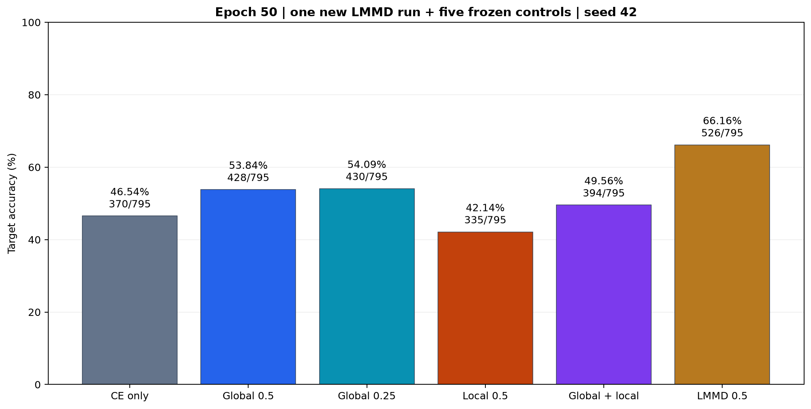
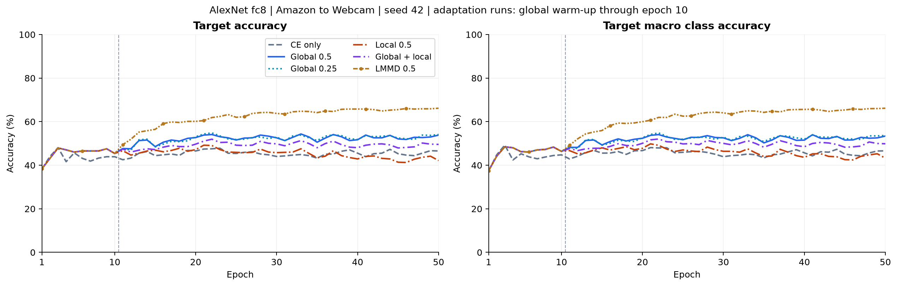
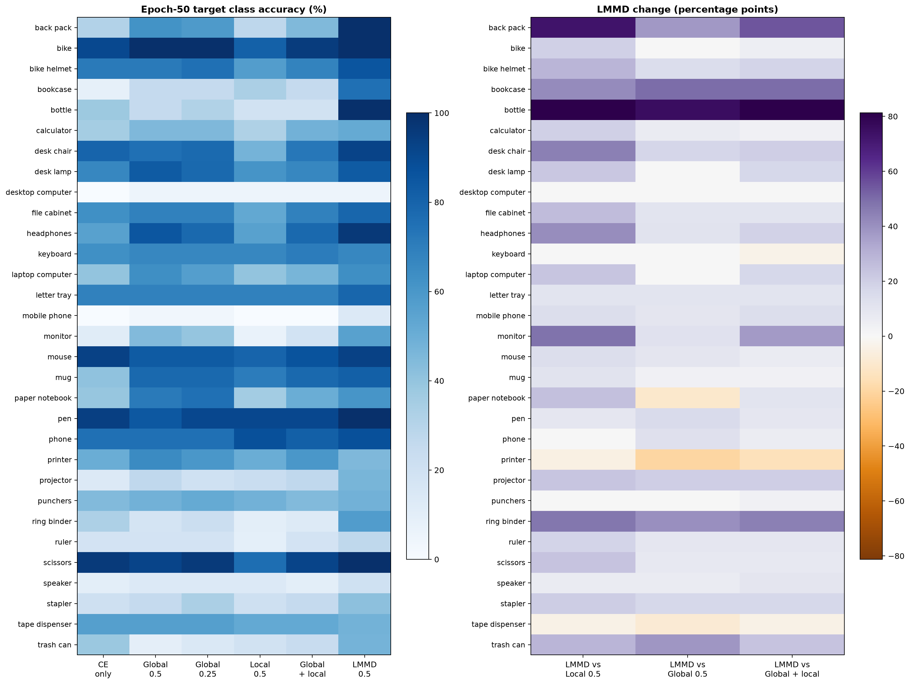
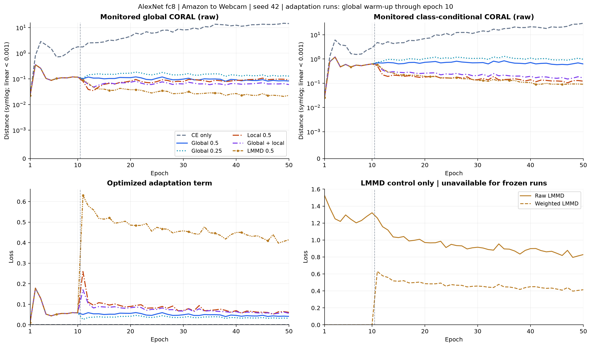
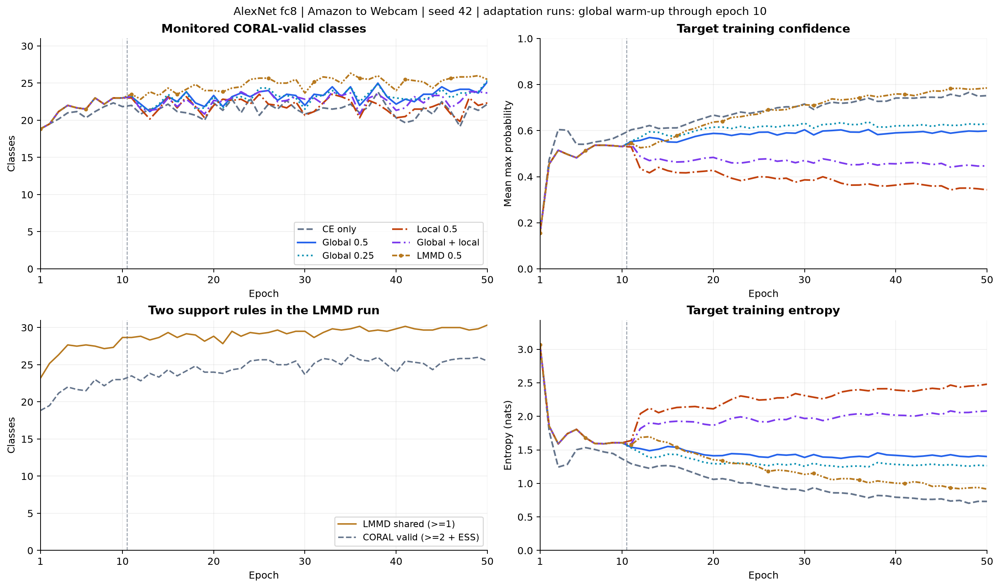
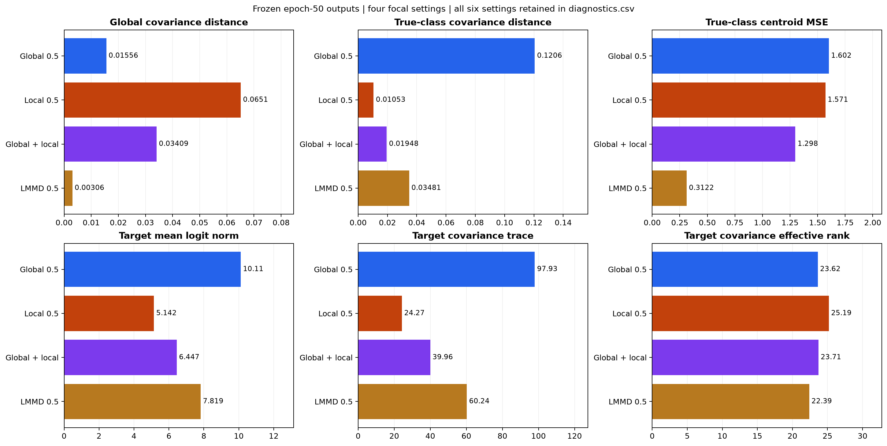
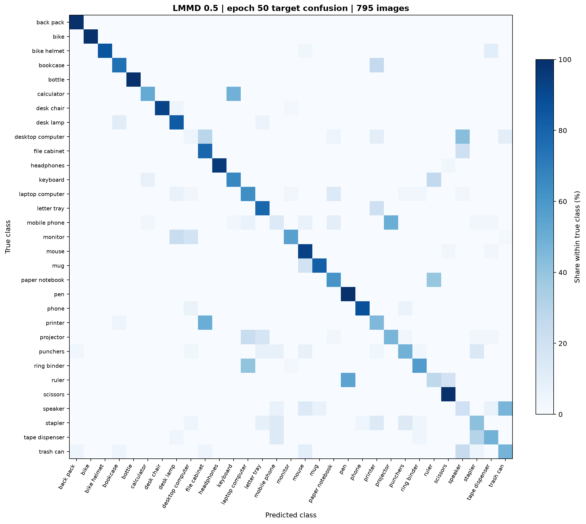

# AlexNet fc8 LMMD 追加对照

日期：2026-10-09。新增一组 50 轮/300 步 LMMD 训练，复用[原五组已完成运行](../report.md)，不改写原结果。

固定第 50 轮 LMMD 目标准确率为 **66.16%（526/795）**，相对类条件 CORAL 为 **+24.03 个百分点**，相对全局 CORAL 为 **+12.33 个百分点**。

## 固定协议与结果

[追加协议](protocol.md)：沿用 seed=42、AlexNet ImageNet-1K V1、fc8 31 维原始 logits、Amazon→Webcam、batch=128、每轮六步、FP32/严格确定性/禁用 TF32。前十轮 `CE + 0.5G`，第十一轮起 `CE + 0.5 LMMD`，SGD 和预处理保持一致。前十轮共同的逐轮/逐步/逐类指标已与原全局组核对一致。

LMMD 采用 [DSAN 作者实现](https://github.com/easezyc/deep-transfer-learning/blob/master/UDA/pytorch1.0/DSAN/lmmd.py) 的五核 RBF 和停止梯度的源/目标类别权重。它对齐类条件核均值嵌入；类条件 CORAL 只约束类内协方差。这是匹配本轮训练配置的损失对照，并非完整 DSAN 复现。

| 设置 | 第 50 轮目标准确率 | 宏平均类别准确率 | 相对 global（百分点） | 相对 local（百分点） | 本次执行 |
|---|---|---|---|---|---|
| no_adaptation | 46.54% (370/795) | 46.60% | -7.30 | +4.40 | 复用 |
| global | 53.84% (428/795) | 53.39% | +0.00 | +11.70 | 复用 |
| global_quarter | 54.09% (430/795) | 53.67% | +0.25 | +11.95 | 复用 |
| local | 42.14% (335/795) | 43.22% | -11.70 | +0.00 | 复用 |
| mixed | 49.56% (394/795) | 49.85% | -4.28 | +7.42 | 复用 |
| lmmd | 66.16% (526/795) | 66.16% | +12.33 | +24.03 | 新增训练 |





固定最终轮不由目标标签选择。LMMD 最佳准确率 66.16%，出现在第 50 轮，仅作补充描述。源域准确率使用源训练图片，不代表独立测试性能。

新增训练循环及逐轮评估耗时 14.13 分钟，峰值显存 1.75 GiB；不包含进程启动和模型初始化时间。

## 同图像配对比较

| 变体 / 对照 | 准确率变化（百分点） | 对照错误→LMMD 正确 | 对照正确→LMMD 错误 | 净新增正确 |
|---|---|---|---|---|
| LMMD / local | +24.03 | 201 | 10 | +191 |
| LMMD / global | +12.33 | 119 | 21 | +98 |
| LMMD / mixed | +16.60 | 146 | 14 | +132 |
| LMMD / global_quarter | +12.08 | 119 | 23 | +96 |
| LMMD / no_adaptation | +19.62 | 175 | 19 | +156 |

全部比较对应相同顺序的 795 张目标图像，不作跨种子显著性推断。原五组配置、环境和完整性重新核验通过；本次只训练 LMMD。



## 损失尺度和类别支持



下表为第 50 轮六个训练批次均值。原五组未记录同批 LMMD，保留为空/未记录，不以零代替。G 和类条件 CORAL 在 LMMD 组仅作监测；预热后只优化 LMMD。

| 设置 | CE | G 原始值 | 类条件 CORAL 原始值 | LMMD 原始值 | 实际加权适应项 |
|---|---|---|---|---|---|
| no_adaptation | 0.02217 | 14.33968 | 29.71618 | 未记录 | 0.00000 |
| global | 0.06514 | 0.08252 | 0.62201 | 未记录 | 0.04126 |
| global_quarter | 0.05392 | 0.12830 | 0.97169 | 未记录 | 0.03207 |
| local | 0.09270 | 0.09054 | 0.12148 | 未记录 | 0.06074 |
| mixed | 0.08633 | 0.06009 | 0.16445 | 未记录 | 0.05613 |
| lmmd | 0.20323 | 0.02268 | 0.09076 | 0.82866 | 0.41433 |

LMMD 目标软权重来自同一次训练前向，温度 1，并停止梯度。共享类为源真实标签与目标 top-1 的交集，至少各出现一次；所有目标图像仍按软权重参与。CORAL 的 >=2/ESS>=2 条件只用于监测，不用于 LMMD。下表为 LMMD 运行的批均值。

| 阶段 | 原始 LMMD | 加权 LMMD | LMMD 共享类别 | CORAL 有效类别（监测） | 原始带宽 b |
|---|---|---|---|---|---|
| 预热 1–10 | 1.29495 | 0.00000 | 26.82/31 | 21.58/31 | 220.3560 |
| LMMD 11–50 | 0.93387 | 0.46693 | 29.37/31 | 24.89/31 | 153.6215 |

五个 RBF 分母为 `b/4, b/2, b, 2b, 4b`，核相加，包含 V-statistic 对角线。带宽为拼接批次的非对角平均平方距离，停止梯度。原始值和加权值不与 CORAL 解释为相同约束强度。

本次零共享类别批次为 0，带宽下限触发批次为 0。权重质量、ESS、支持和无效类空距离见 [lmmd_class_metrics.csv](lmmd_class_metrics.csv)；同批 CORAL 监测见 [coral_class_metrics.csv](coral_class_metrics.csv)。



## 冻结模型事后诊断

目标真实标签只在评估和本节事后诊断使用，不进入训练损失、权重或支持筛选。全域 logits 关闭 Dropout，与训练批次损失分开解释。下表距离均采用相同 fc8/31 维定义；没有将全域 LMMD 与训练批 LMMD 混用。

| 设置 | 全局协方差距离 | 真实类协方差距离 | 真实类中心 MSE | 目标 logits 范数 | 目标协方差迹 | 目标有效秩 |
|---|---|---|---|---|---|---|
| no_adaptation | 10.9677 | 3.32446 | 10.9562 | 22.9703 | 442.3350 | 15.614 |
| global | 0.0155584 | 0.120577 | 1.60193 | 10.1107 | 97.9291 | 23.617 |
| global_quarter | 0.0257941 | 0.174696 | 1.90232 | 11.1514 | 119.2185 | 22.511 |
| local | 0.0651032 | 0.0105326 | 1.57096 | 5.1423 | 24.2701 | 25.193 |
| mixed | 0.0340892 | 0.0194795 | 1.29807 | 6.4469 | 39.9579 | 23.712 |
| lmmd | 0.00306001 | 0.0348095 | 0.312181 | 7.8186 | 60.2351 | 22.394 |



完整两域范数、迹、有效秩及逐类结构见 [diagnostics.csv](diagnostics.csv)、[class_diagnostics.csv](class_diagnostics.csv)。有效秩沿用协方差特征值归一化后的熵指数。目标混淆矩阵如下，原始计数见 [confusion_counts.csv](confusion_counts.csv)。



## 解释与验收

本次 LMMD 在两个主要比较中均提高了准确率。 LMMD 的真实类中心 MSE 为 0.312181，类条件 CORAL 为 1.57096，全局组为 1.60193。协方差距离、类别中心及幅度/谱变化应与准确率和支持覆盖共同评价。

LMMD 的真实类协方差距离为 0.0348095，大于 local 的 0.0105326，但分类准确率更高。这进一步说明较小的类内协方差距离不足以评价迁移效果。中心距离的改善与分类提升同时出现，尚未通过额外消融确定因果关系。

本次仍为单种子、单方向探索。LMMD 与自定义类条件 CORAL 在统计对象、核函数、支持筛选和数值尺度上均有差异，因此此对照不能单独确定其中某一因素的因果贡献，也不能代表原论文完整方法的结果。

- 六项数学边界检查通过，特征梯度有限，目标概率不接收梯度。
- 另直接调用作者原始权重和核函数进行 FP32 对照，损失绝对差 0，最大特征梯度差 2.24e-08；见 [author_validation.json](author_validation.json)。
- LMMD 完成 50 轮、300 步，保存 9,300 条 LMMD 类记录和 9,300 条 CORAL 监测类记录；第十一轮调度正确，前十轮与原全局组共同指标在 1e-6 内一致。
- CSV、训练日志、最终 NPZ、逐图预测及 2,817/795 张全域准确率互相一致；环境与旧对照一致，逐图路径顺序一致。原五组只复用，未新增训练。

```powershell
uv run --no-sync python -m src.experiments.lmmd.run
uv run --no-sync python -m src.experiments.lmmd.run --resume
uv run --no-sync python -m src.experiments.lmmd.verify
uv run --no-sync python -m src.plotting.plot_lmmd
```

[summary.csv](summary.csv)、[epoch_metrics.csv](epoch_metrics.csv)、[step_metrics.csv](step_metrics.csv)、[prediction_changes.csv](prediction_changes.csv)、[verification.json](verification.json)、[provenance.json](provenance.json) 保留可核对数字。新运行的原始配置、环境、日志、CSV 和最终 logits/预测快照位于 `data/lmmd/`；原五组快照保持在 `../data/<setting>/`，完整新运行位于 `results/subdomain_coral/lmmd/`。
