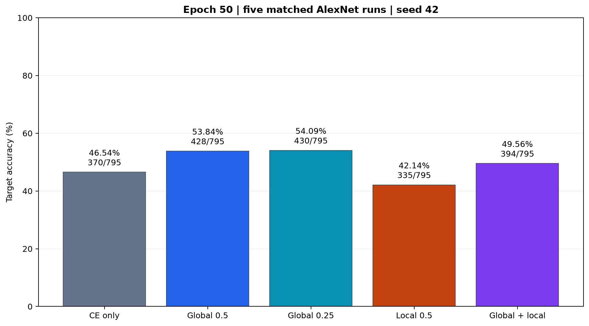
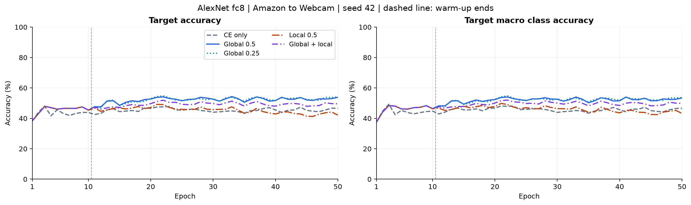
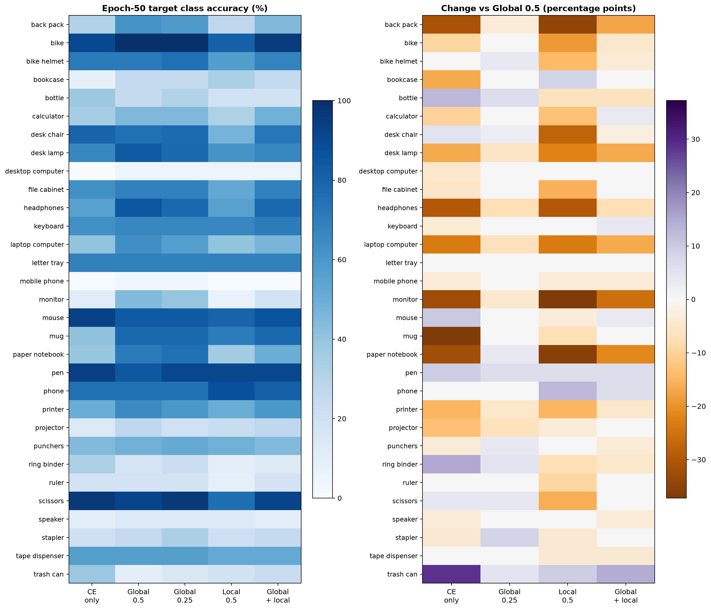
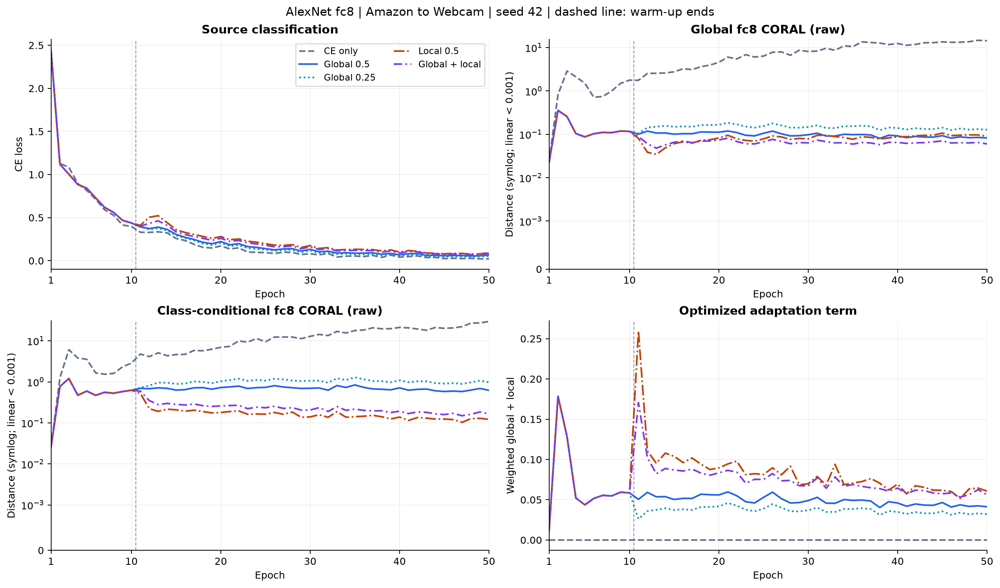
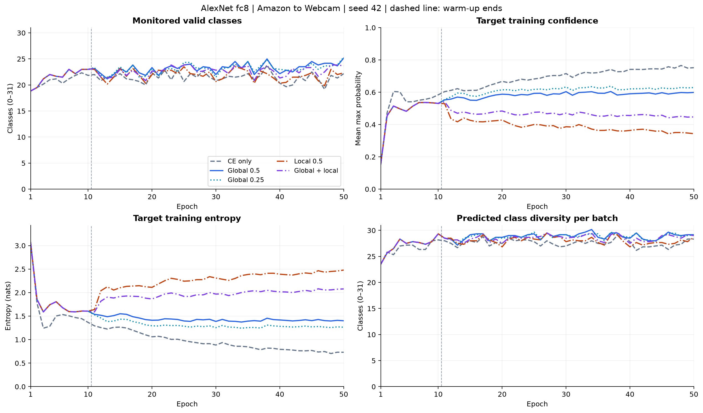
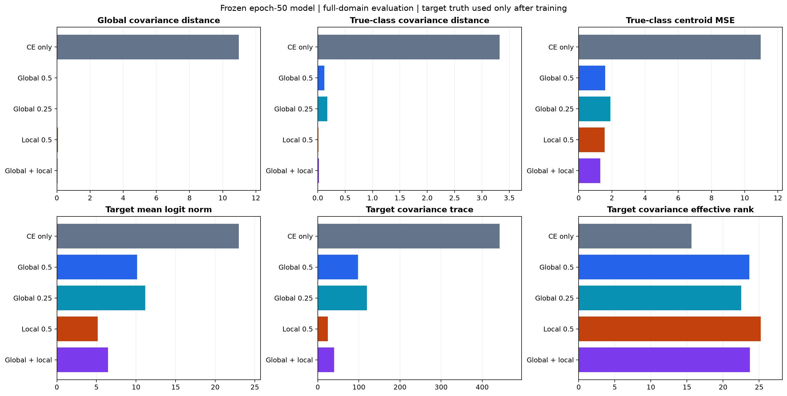

# AlexNet fc8 类条件 CORAL 五组实验

日期：2026-10-09。Office-31 Amazon→Webcam，seed=42，全部五组重新训练 50 轮。主结果为固定第 50 轮，最佳轮仅描述。

追加的 [LMMD 对照与六组比较](lmmd/report.md)复用本报告五组，仅新增一组 LMMD 训练。

类条件替换相对全局 CORAL 的变化为 **-11.70 个百分点**；联合组相对较弱全局对照为 **-4.53 个百分点**，相对全局 0.5 为 **-4.28 个百分点**。

## 设计与主要结果

[固定协议](protocol.md)采用 ImageNet-1K V1 AlexNet、batch=128、workers=0、每轮六步；四适应组前十轮统一 0.5 全局 CORAL，第十一轮切换。`global_quarter` 和 `local` 的名称指预热后的损失。全局/类条件联合的系数各为 0.25。

方法借鉴 [DSAN](https://jd92.wang/assets/files/a24tnnls20.pdf) 的类别软权重，其原方法使用 LMMD；本轮为自行定义的类条件协方差 CORAL。目标权重来自同一次训练前向的 softmax，停止梯度。目标训练标签在训练循环边界丢弃。

| 设置 | 第 50 轮目标准确率 | 宏平均类别准确率 | 相对 global（百分点） | 最佳准确率 / epoch，仅描述 |
|---|---|---|---|---|
| no_adaptation | 46.54% (370/795) | 46.60% | -7.30 | 48.05% / 3 |
| global | 53.84% (428/795) | 53.39% | +0.00 | 54.34% / 33 |
| global_quarter | 54.09% (430/795) | 53.67% | +0.25 | 54.84% / 22 |
| local | 42.14% (335/795) | 43.22% | -11.70 | 49.18% / 21 |
| mixed | 49.56% (394/795) | 49.85% | -4.28 | 51.95% / 22 |





源域评估使用源训练图片，不是独立测试集。五组使用相同原始数据、初始化、采样及评估协议；旧实验只保留为历史资料，不混入本表。

## 三个预先指定的比较

| 变体 / 对照 | 准确率变化（百分点） | 对照错误→变体正确 | 对照正确→变体错误 | 净新增正确 |
|---|---|---|---|---|
| local / global | -11.70 | 14 | 107 | -93 |
| mixed / global_quarter | -4.53 | 17 | 53 | -36 |
| mixed / global | -4.28 | 13 | 47 | -34 |

local/global 比较预热后替换对齐方式；mixed/global_quarter 比较固定全局系数下增加局部约束；mixed/global 比较固定名义总系数下分配约束。原始损失尺度不同，同系数不代表同梯度强度。paired change 数来自相同 795 张目标图像的最终预测，不作跨种子显著性推断。



## 损失与类别覆盖



以下为第 50 轮六个训练批次的均值，保留未优化项的原始监测值；与冻结模型的全域距离分开报告。

| 设置 | CE | G 原始值 | L 原始值 | 加权 G | 加权 L |
|---|---|---|---|---|---|
| no_adaptation | 0.02217 | 14.33968 | 29.71618 | 0.00000 | 0.00000 |
| global | 0.06514 | 0.08252 | 0.62201 | 0.04126 | 0.00000 |
| global_quarter | 0.05392 | 0.12830 | 0.97169 | 0.03207 | 0.00000 |
| local | 0.09270 | 0.09054 | 0.12148 | 0.00000 | 0.06074 |
| mixed | 0.08633 | 0.06009 | 0.16445 | 0.01502 | 0.04111 |

所有设置均监测 G 和 L，即使该项没有参与优化。L 按有效类平均；有效类要求源计数 >=2、目标 top-1 计数 >=2、目标质量 >1e-12、有效样本量 >=2。全部目标图像仍以软概率参与有效类协方差。无效类距离在 CSV 留空；无有效类批次返回连接到特征的零值。

| 设置 | 预热后每批平均有效类 | 预热后零有效类批次 | 最后轮训练置信度 | 最后轮训练熵（nats） | 训练耗时（分钟） | 峰值显存（GiB） |
|---|---|---|---|---|---|---|
| no_adaptation | 21.45/31 | 0 | 0.752 | 0.731 | 12.24 | 1.39 |
| global | 23.23/31 | 0 | 0.599 | 1.401 | 12.99 | 1.75 |
| global_quarter | 23.14/31 | 0 | 0.629 | 1.264 | 13.59 | 1.75 |
| local | 21.92/31 | 0 | 0.343 | 2.479 | 13.04 | 1.75 |
| mixed | 22.72/31 | 0 | 0.447 | 2.078 | 9.32 | 1.75 |



类别支持筛选会改变参与平均的类别集合，不能仅由 L 的下降推断类条件对齐改善。逐批权重质量、有效样本量、top-1 计数和跳过原因见 [class_metrics.csv](class_metrics.csv)。

## 冻结模型的事后诊断

下表在训练完成后使用第 50 轮全域 logits 计算；真实类诊断才使用目标真实标签，训练与调度不读取这些标签。距离均在相同的 fc8、31 维定义下比较。全域评估关闭 Dropout，与训练批次损失分开解释。

| 设置 | 全局协方差距离 | 真实类平均协方差距离 | 真实类中心 MSE | 目标协方差迹 | 目标有效秩 |
|---|---|---|---|---|---|
| no_adaptation | 10.9677 | 3.32446 | 10.9562 | 442.335 | 15.614 |
| global | 0.0155584 | 0.120577 | 1.60193 | 97.9291 | 23.617 |
| global_quarter | 0.0257941 | 0.174696 | 1.90232 | 119.218 | 22.511 |
| local | 0.0651032 | 0.0105326 | 1.57096 | 24.2701 | 25.193 |
| mixed | 0.0340892 | 0.0194795 | 1.29807 | 39.9579 | 23.712 |

- local/global：真实类协方差距离 0.120577 → 0.0105326；类别中心 MSE 1.60193 → 1.57096；目标准确率变化 -11.70 个百分点。
- mixed/global_quarter：真实类协方差距离 0.174696 → 0.0194795；类别中心 MSE 1.90232 → 1.29807；目标准确率变化 -4.53 个百分点。
- mixed/global：真实类协方差距离 0.120577 → 0.0194795；类别中心 MSE 1.60193 → 1.29807；目标准确率变化 -4.28 个百分点。

- local/global：预热后每批平均有效类 23.23 → 21.92；目标 logits 平均范数 10.111 → 5.142；目标协方差有效秩 23.617 → 25.193。
- mixed/global_quarter：预热后每批平均有效类 23.14 → 22.72；目标 logits 平均范数 11.151 → 6.447；目标协方差有效秩 22.511 → 23.712。



完整的两域 logits 范数、协方差迹、有效秩、软预测类距离和置信度见 [diagnostics.csv](diagnostics.csv)；各类别中心、协方差及准确率见 [class_diagnostics.csv](class_diagnostics.csv)。有效秩定义为归一化非负协方差特征值的熵指数；全零协方差记为零。中心 MSE 不参与训练损失。

混淆矩阵：[无适应](assets/confusion_no_adaptation.png)、[全局 0.5](assets/confusion_global.png)、[较弱全局](assets/confusion_global_quarter.png)、[类条件](assets/confusion_local.png)、[联合](assets/confusion_mixed.png)。矩阵按真实类别归一化；[confusion_counts.csv](confusion_counts.csv) 保留全部原始计数。

## 结果解释

本轮三个预先指定比较均为负结果，未观察到类条件约束改善全局 CORAL 的分类效果。这一结论限定于本协议、seed=42 和 Amazon→Webcam。

local 的真实类协方差距离更小，但分类准确率下降，说明距离减小没有转化为分类收益。

local 的目标 logits 平均范数为 5.142，全局组为 10.111；目标协方差迹分别为 24.270 和 97.929，有效秩分别为 25.193 和 23.617。解释协方差距离时需要同时考虑这些幅度与谱变化。上述数值不足以单独确定伪标签误差、正则强度或特征退化各自的因果贡献。

## 验证与复现

- 数学检查通过：单类别退化为原 CORAL、类别缺失/单样本/无有效类别、有限特征梯度、软概率停止梯度，以及其他 top-1 类图像仍贡献软权重。
- 正式结果核验：5 组、250 轮、1500 步、46500 条类别记录；四适应组前十轮逐批/逐轮/逐类指标在 1e-6 容差内一致，第十一轮系数正确切换。
- CSV、逐轮日志、最终 NPZ、逐图预测与汇总互相一致；源/目标每次评估分别覆盖 2,817/795 张。固定最终轮的选择不使用目标准确率。

```powershell
uv run --no-sync python -m src.experiments.subdomain.run
uv run --no-sync python -m src.experiments.subdomain.run --resume
uv run --no-sync python -m src.experiments.subdomain.verify
uv run --no-sync python -m src.plotting.plot_subdomain
```

[summary.csv](summary.csv)、[epoch_metrics.csv](epoch_metrics.csv)、[step_metrics.csv](step_metrics.csv)、[prediction_changes.csv](prediction_changes.csv)、[verification.json](verification.json)、[provenance.json](provenance.json) 提供可检查的数字及来源；`data/<setting>/` 保存本报告使用的原始配置、日志、CSV 和最终 logits/预测快照，完整训练产物位于 `results/subdomain_coral/`。

本轮为单 seed、单方向探索。协方差接近并不保证类别中心正确或分类改善，特征尺度变化也会影响距离；应结合准确率、类别覆盖、中心和谱诊断解释。每类批内样本有限，伪标签误差、类别支持筛选和损失尺度变化的贡献未分别隔离。本轮不以目标标签调节阈值或选取模型，不将单次增益作为统计显著性结论。
