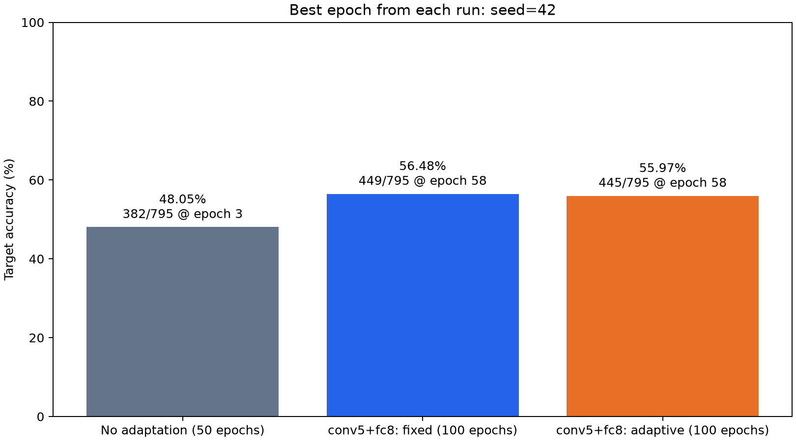
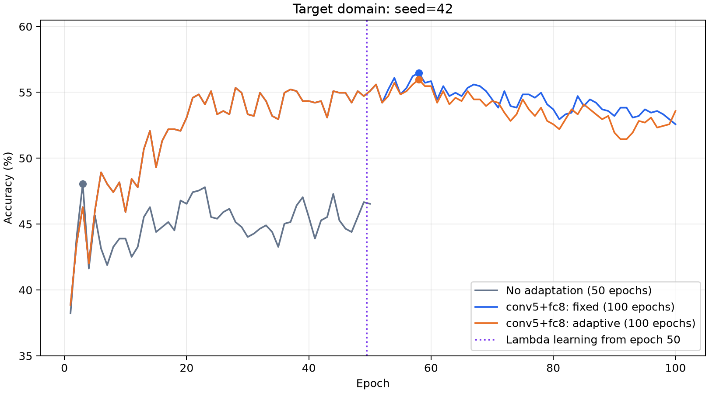
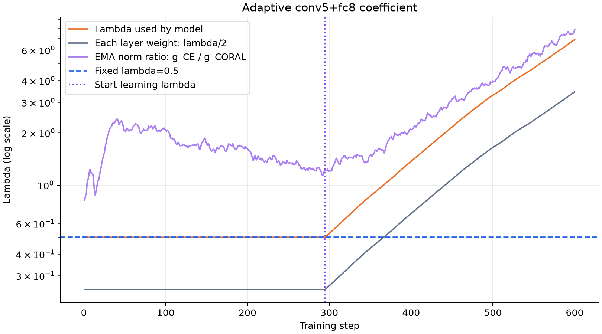
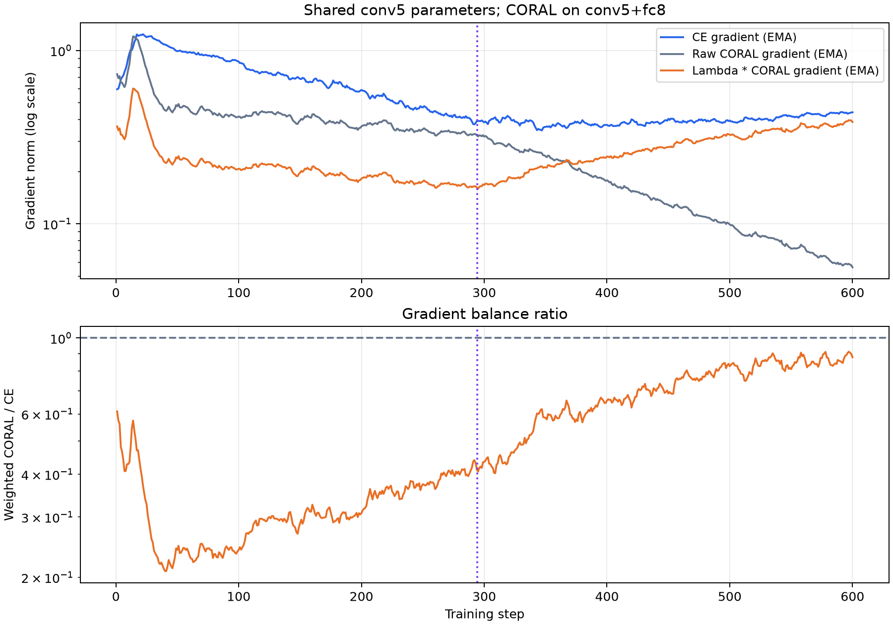
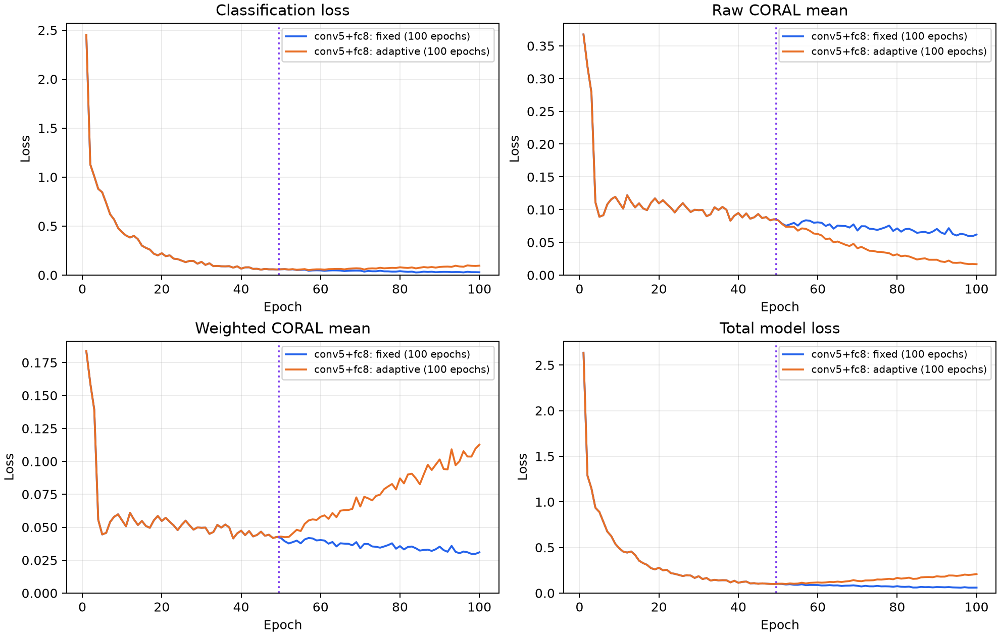
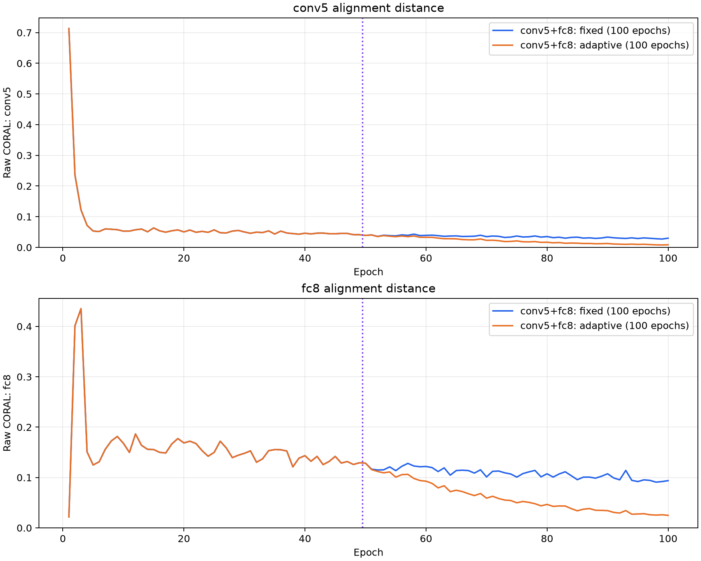

# conv5+fc8：自适应 λ 实验

在 conv5+fc8 计算 CORAL，取所选层损失的均值，沿用 seed=42、100 epochs、batch=128 和原 SGD 配置。原始基线直接引用 `results/original/no_adaptation`；固定 conv5+fc8 来自 `C:\Users\Zoisythe\Code\Project\Pytorch-Deep-CORAL\results\fixed_lambda\conv5_fc8`，该固定运行共 100 轮。

前 49 轮固定 λ=0.5，第 50 轮起学习 λ=exp(s)。在共享 conv5 weight/bias 上测量两项未加权梯度，以 decay=0.9 的 EMA 平滑，并使用独立 Adam（lr=0.01）最小化 `(λ·EMA(g_CORAL)−EMA(g_CE))²`。范数与模型使用的 λ 均 detach；λ 范围为 [0.0001,100]。

学习一个共享 λ，每层有效系数为 λ/2；固定阶段每层系数为 0.2500。

固定阶段维护 EMA，但不更新 λ 或 Adam 状态。以全部训练轮次中的最佳目标准确率保留本次结果，平分时选较早轮次。

| 设置 | 总轮数 | 最佳轮目标准确率 | 正确数 | 相对固定 conv5+fc8 最佳轮 | epoch | λ |
|---|---:|---:|---:|---:|---:|---:|
| No adaptation (50 epochs) | 50 | 48.05% | 382/795 | -8.43 pp | 3 | 0.0000 |
| conv5+fc8: fixed (100 epochs) | 100 | 56.48% | 449/795 | +0.00 pp | 58 | 0.5000 |
| conv5+fc8: adaptive (100 epochs) | 100 | 55.97% | 445/795 | -0.50 pp | 58 | 0.8284 |

完成 100 轮、600 次模型更新、306 次 λ 更新。λ：0.5 → 6.935585；实际使用范围 0.500000～6.887103。
自适应阶段平均梯度平衡比（λ·EMA(g_CORAL)/EMA(g_CE)）：0.7032；平均梯度方向余弦：-0.5228。

最终轮补充：固定 conv5+fc8 为 52.58%，自适应 conv5+fc8 为 53.58%。

共同轮次第 50 轮：固定 conv5+fc8 为 55.09%，自适应为 55.09%。

逐批动态加权后再取轮均值，不能用 λ 均值乘原始 CORAL 均值替代。

数据见 `summary.csv`、`../metrics.csv`、`../step_metrics.csv`；数据来源见 `provenance.json`，运行环境见 `../environment.json`。

本次保留第 58 轮（adaptive 阶段），该轮 λ 均值为 0.828397。仅在自适应阶段选取的最佳结果为第 58 轮、55.97%。

`../best_epoch.json`、`../best_epoch/metrics.csv` 和 `../best_epoch/step_metrics.csv` 保存最佳轮完整指标；`../best_epoch/{source,target}_predictions.csv` 和 `../best_epoch/evaluation.npz` 保存逐图预测及 logits。
