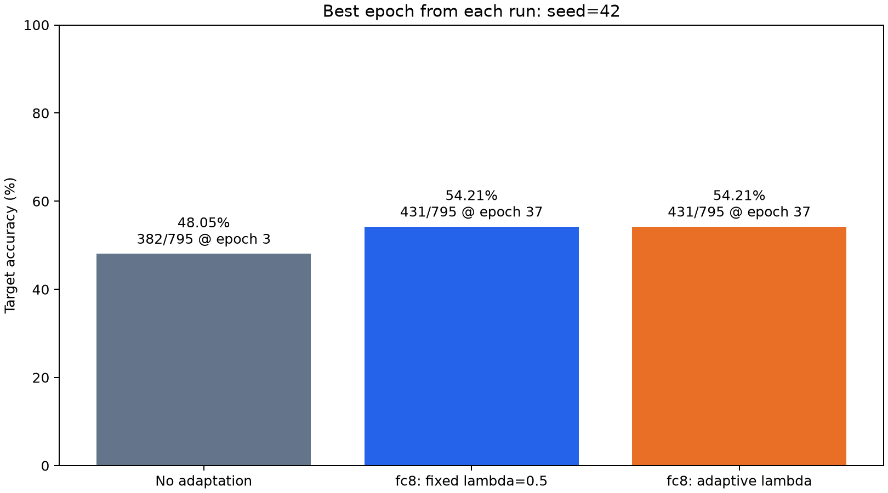
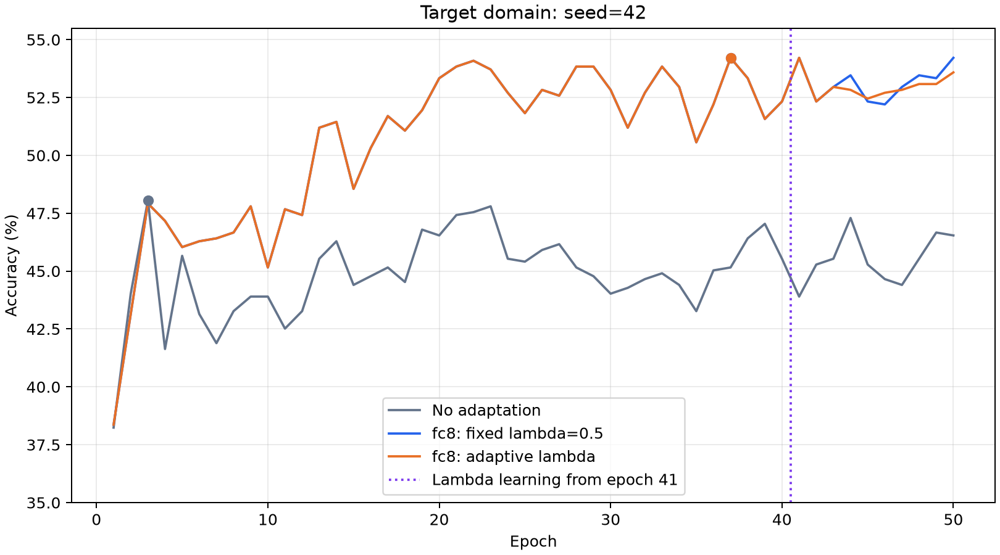
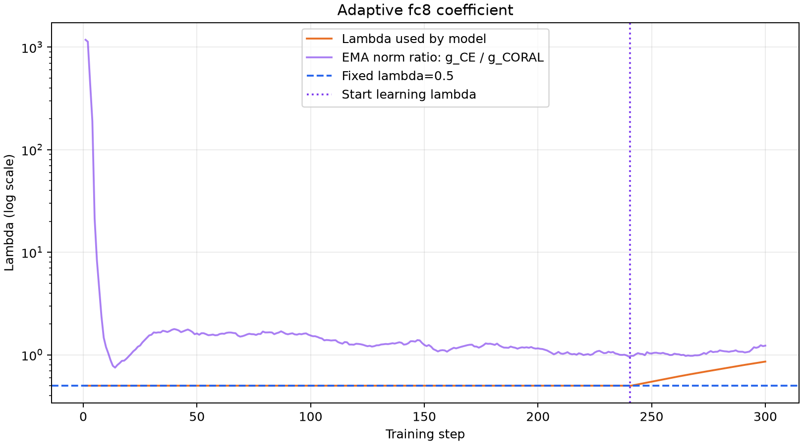
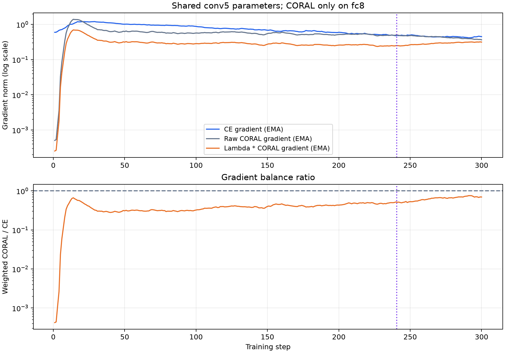
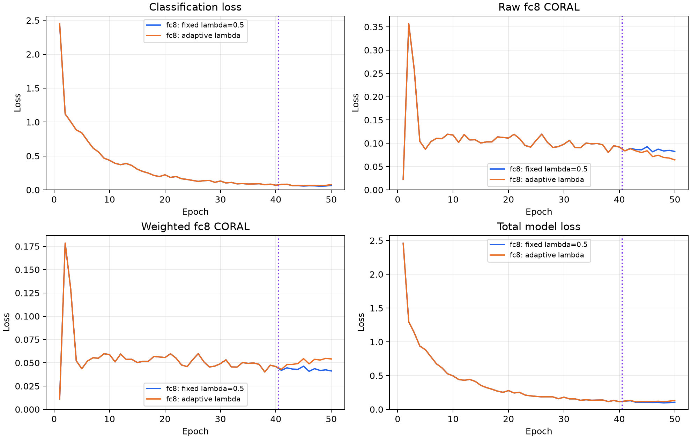

# 纯 fc8：自适应 λ 实验

仅在 fc8 计算 CORAL，沿用 seed=42、50 epochs、batch=128 和原 SGD 配置。复用 `results/original/no_adaptation` 与 `results/original/fc8`，未重跑对照组。

前 40 轮固定 λ=0.5，第 41 轮起学习 λ=exp(s)。在共享 conv5 weight/bias 上测量两项未加权梯度，以 decay=0.9 的 EMA 平滑，并使用独立 Adam（lr=0.01）最小化 `(λ·EMA(g_CORAL)−EMA(g_CE))²`。范数与模型使用的 λ 均 detach；λ 范围为 [0.0001,100]。

固定阶段维护 EMA，但不更新 λ 或 Adam 状态。以全部训练轮次中的最佳目标准确率保留本次结果，平分时选较早轮次。

| 设置 | 最佳轮目标准确率 | 正确数 | 相对固定 fc8 最佳轮 | epoch | λ |
|---|---:|---:|---:|---:|---:|
| No adaptation | 48.05% | 382/795 | -6.16 pp | 3 | 0.0000 |
| fc8: fixed lambda=0.5 | 54.21% | 431/795 | +0.00 pp | 37 | 0.5000 |
| fc8: adaptive lambda | 54.21% | 431/795 | +0.00 pp | 37 | 0.5000 |

完成 50 轮、300 次更新。λ：0.5 → 0.866080；实际使用范围 0.500000～0.858791。
自适应阶段平均梯度平衡比（λ·EMA(g_CORAL)/EMA(g_CE)）：0.6346；平均梯度方向余弦：-0.4945。

最终轮补充：固定 fc8 为 54.21%，自适应 fc8 为 53.58%。

逐批动态加权后再取轮均值，不能用 λ 均值乘原始 CORAL 均值替代。

数据见 `summary.csv`、`../metrics.csv`、`../step_metrics.csv`；数据来源见 `provenance.json`，运行环境见 `../environment.json`。

本次保留第 37 轮（fixed 阶段），该轮 λ 均值为 0.500000。仅在自适应阶段选取的最佳结果为第 41 轮、54.21%。

`../best_epoch.json`、`../best_epoch/metrics.csv` 和 `../best_epoch/step_metrics.csv` 保存最佳轮完整指标；`../best_epoch/{source,target}_predictions.csv` 和 `../best_epoch/evaluation.npz` 保存逐图预测及 logits。
