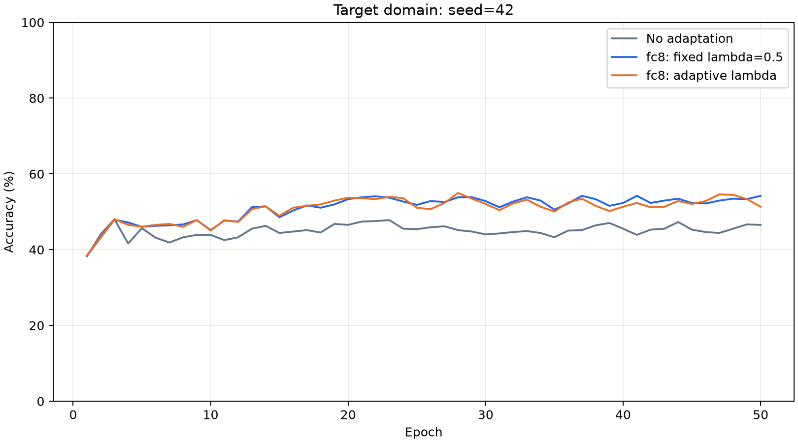
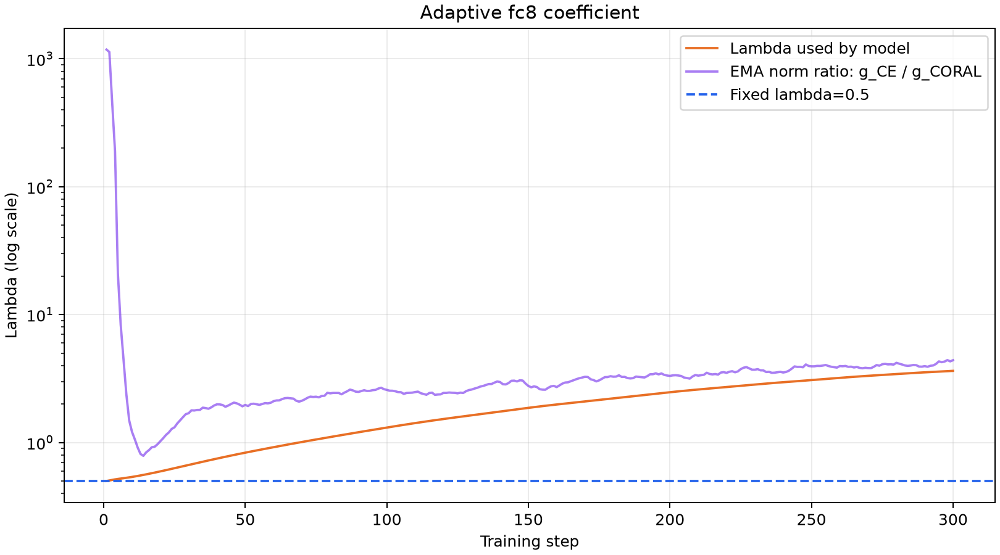
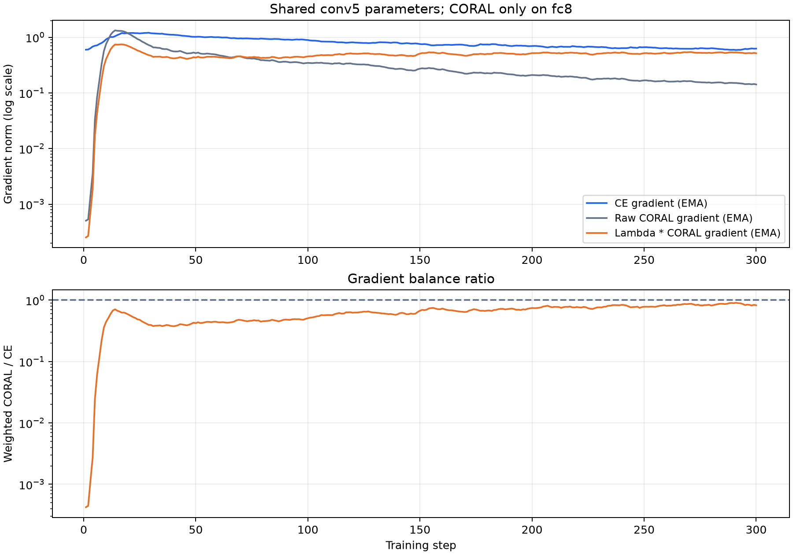
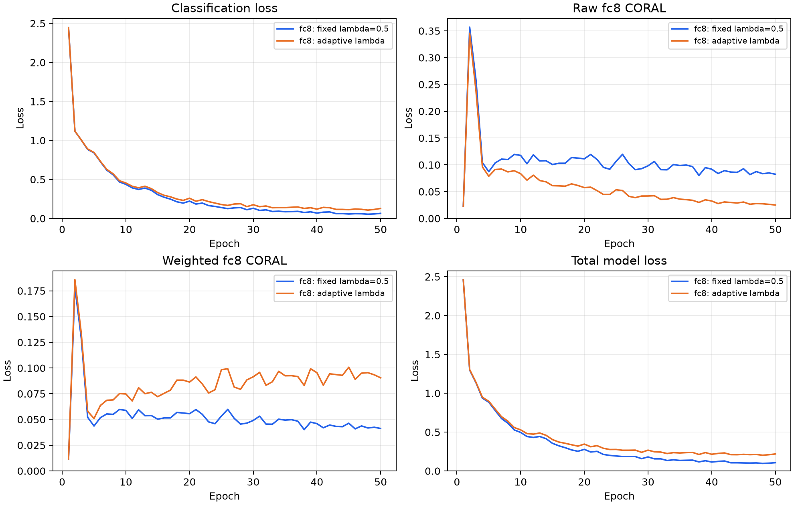

# 纯 fc8：自适应 λ 实验

仅在 fc8 计算 CORAL，沿用 seed=42、50 epochs、batch=128 和原 SGD 配置。复用 `results/original/no_adaptation` 与 `results/original/fc8`，未重跑对照组。

λ 从 0.5 开始，令 λ=exp(s)。在共享 conv5 weight/bias 上测量两项未加权梯度，以 decay=0.9 的 EMA 平滑，并使用独立 Adam（lr=0.01）最小化 `(λ·EMA(g_CORAL)−EMA(g_CE))²`。范数与模型使用的 λ 均 detach；λ 范围为 [0.0001,100]。

| 设置 | 第50轮目标准确率 | 正确数 | 相对固定 fc8 | 最佳轮准确率 | 最佳轮 |
|---|---:|---:|---:|---:|---:|
| No adaptation | 46.54% | 370/795 | -7.67 pp | 48.05% | 3 |
| fc8: fixed lambda=0.5 | 54.21% | 431/795 | +0.00 pp | 54.21% | 37 |
| fc8: adaptive lambda | 51.32% | 408/795 | -2.89 pp | 54.97% | 28 |

完成 50 轮、300 次更新。λ：0.5 → 3.644643；实际使用范围 0.500000～3.634061。
最后 10 轮平均梯度平衡比（λ·EMA(g_CORAL)/EMA(g_CE)）：0.8317；平均梯度方向余弦：-0.6632。

第 50 轮，原始 CORAL 从固定组的 0.082505 降到 0.025063；加权 CORAL 则从 0.041252 升到 0.090464。CE 从 0.065046 变为 0.127856。
这个规则平衡梯度强度，没有处理梯度方向冲突。负余弦表示两项更新方向相互抵消；增大 λ 会放大这种作用。更小的全局协方差距离因此可以伴随更高的分类损失，不能直接作为更好分类效果的优化目标。

逐批动态加权后再取轮均值，不能用 λ 均值乘原始 CORAL 均值替代。

数据见 `summary.csv`、`../metrics.csv`、`../step_metrics.csv`；代码与数据来源哈希见 `provenance.json` 和 `../environment.json`。
