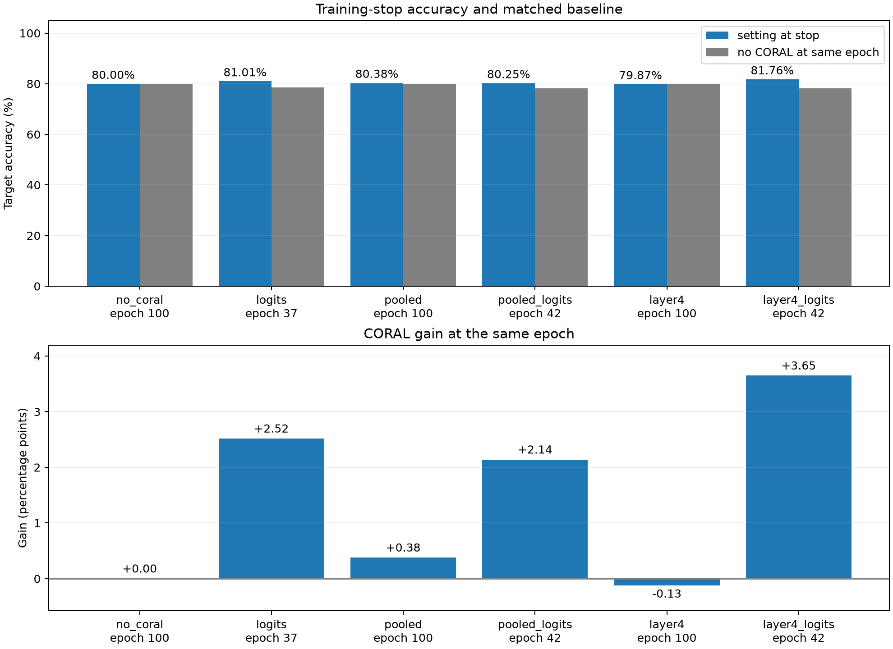
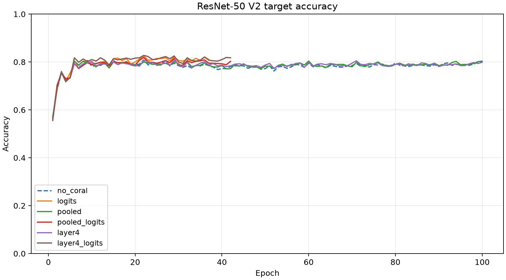
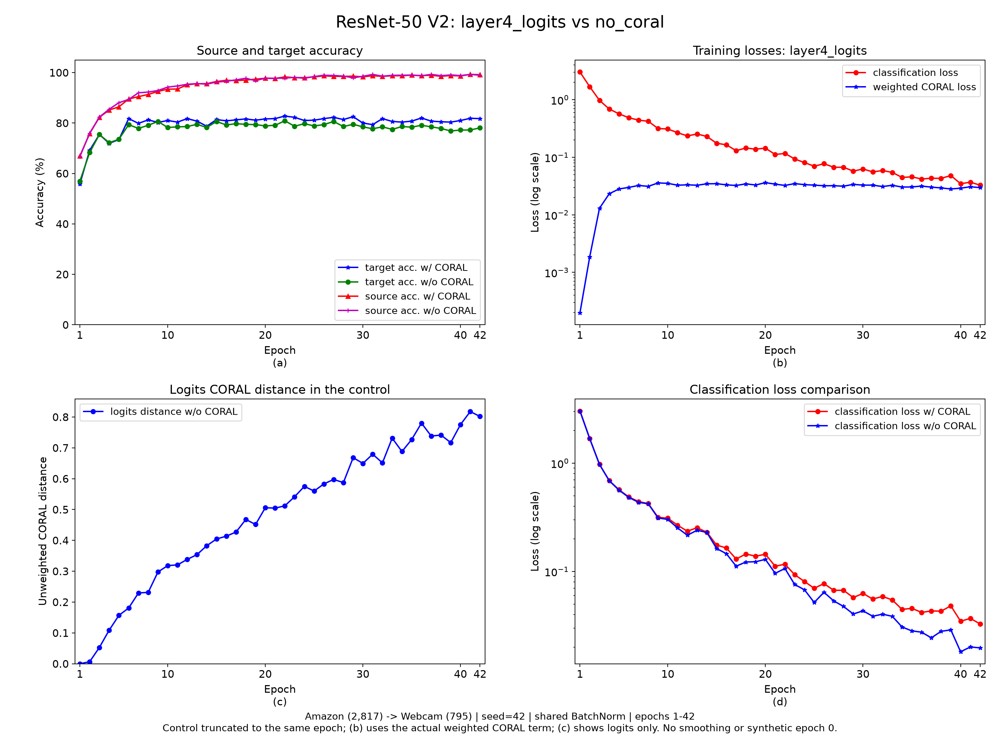
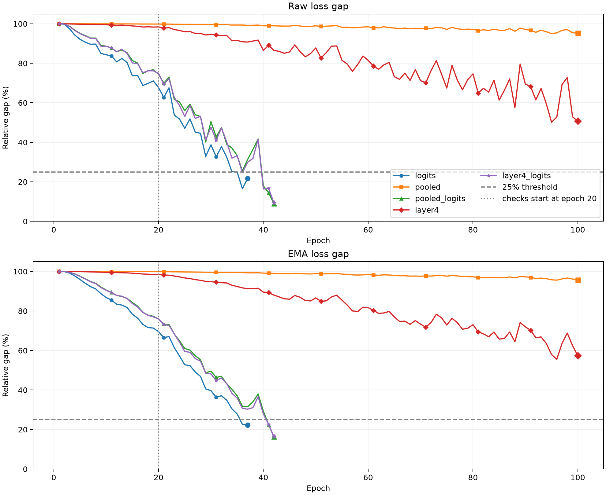

# ResNet-50 V2 + CORAL 六组实验

日期：2026-10-08。任务：Office-31 Amazon→Webcam，31 类，单种子探索性比较。

## 研究问题与实验设计

本实验检验：在 ImageNet-1K V2 预训练 ResNet-50、两域共同更新 BatchNorm 的固定配置下，CORAL 是否提供额外收益，以及收益是否依赖对齐位置。
它没有分离网络结构、预训练方案和 BatchNorm 的各自贡献，历史 AlexNet 结果仅作背景，不能作为匹配的跨架构对照。

使用 ImageNet-1K V2 预训练、seed=42、Amazon→Webcam、batch=32，每轮 24 步。全网络 SGD 微调，骨干 lr=0.001、分类头 lr=0.01，λ=0.5，多层取均值；双层实际各 0.25。
BatchNorm 每步按源域、目标域顺序更新，评估冻结统计量。无 CORAL 对照同样使用目标域更新统计量，因此本表衡量相同共享 BatchNorm 策略下 CORAL 的额外收益，不是纯 source-only 比较。

| 设置 | 对齐对象 | 实际损失系数 |
| --- | --- | --- |
| no_coral | 无 | 0 |
| logits | logits | logits: 0.5 |
| pooled | pooled | pooled: 0.5 |
| pooled_logits | pooled, logits | pooled: 0.25, logits: 0.25 |
| layer4 | layer4 | layer4: 0.5 |
| layer4_logits | layer4, logits | layer4: 0.25, logits: 0.25 |

模型显式使用 `ResNet50_Weights.IMAGENET1K_V2`，替换为 31 类头（权重标准差 0.005、偏置 0.01）。保持原始 JPG、`Resize(224)` 和各域归一化，不增加增强。
SGD momentum=0.9、weight decay=0.0005，学习率与 λ 恒定；workers=0、FP32、严格确定性、关闭 TF32，无激活检查点。目标域标签只用于评估和补充预测归档，不进入训练损失或早停信号。完整设计见 [锁定协议](C:/Users/Zoisythe/Code/Project/Pytorch-Deep-CORAL/reports/resnet50-protocol.md)。

## 停止轮结果

| 设置 | 停止轮 | 原因 | 目标准确率 | 对照同轮准确率 | 增益（百分点） | 最佳准确率 / 轮次（补充） |
| --- | ---: | --- | ---: | ---: | ---: | ---: |
| no_coral | 100 | max_epochs | 80.00% (636/795) | 80.00% | +0.00 | 80.88% / 22 |
| logits | 37 | loss_balance | 81.01% (644/795) | 78.49% | +2.52 | 82.52% / 22 |
| pooled | 100 | max_epochs | 80.38% (639/795) | 80.00% | +0.38 | 80.38% / 6 |
| pooled_logits | 42 | loss_balance | 80.25% (638/795) | 78.11% | +2.14 | 81.89% / 22 |
| layer4 | 100 | max_epochs | 79.87% (635/795) | 80.00% | -0.13 | 81.01% / 29 |
| layer4_logits | 42 | loss_balance | 81.76% (650/795) | 78.11% | +3.65 | 82.77% / 22 |

停止轮准确率最高为 **layer4_logits：81.76%**。CORAL 组中同轮增益最大为 **layer4_logits：+3.65 个百分点**。这两项回答不同问题，不将停止轮不同的原始准确率差全部归因于 CORAL。
增益定义为该设置停止轮准确率减去 no_coral 在相同 epoch 的准确率，而非统一减去对照第 100 轮成绩。未触发早停的组完整达到 100 轮；最佳轮及其准确率只作补充，不用于训练停止或参数选择。




## 四宫格训练曲线

参考仓库 `plots.png` 的布局，以停止轮准确率最高的 layer4_logits 作描述性展示，对照截取至同一轮。
(a) 两域全量评估准确率；(b) CE 与实际加权 CORAL 损失；(c) 无 CORAL 对照的 logits 距离；(d) 两组 CE。
损失面板使用对数纵轴以保留初期高损失和后期变化；不平滑、不补第 0 轮或早停后的数据。



## 结果解释：迁移表现与 CORAL 的额外收益

**较好的无 CORAL 成绩支持配置有效，尚不能证明是结构本身的跨域泛化优势。** no_coral 第 100 轮达到 80.00%，说明这套预训练、微调与共享 BN 配置已有较好的目标准确率。
但目标域图像参与了 BN 统计量更新，因此这一成绩包含结构、V2 预训练和目标域统计信息的共同作用。实验没有纯源域 BN 对照，也没有一致预训练、采样和训练协议下的 AlexNet 对照，不能识别各因素的独立贡献。

**CORAL 收益依赖对齐位置，不能笼统归纳为提升不明显。** 单独 pooled、layer4 的同轮增益分别为 +0.38、-0.13 个百分点，收益有限。
包含 logits 的三组同轮增益为 +2.52、+2.14、+3.65 个百分点，均为正向观察。
以 layer4_logits 第 42 轮为例，相同 epoch 的对照判对 621/795 张，CORAL 组判对 650/795 张，多判对 29 张；错误数从 174 减至 145，相对减少 16.67%。这一差异不宜仅因准确率曲线接近而忽略，但其跨种子稳定性尚未验证。

**联合设置的优势不能单独归因于新增 layer4。** logits 单层系数为 0.5，而联合组的 logits 与 layer4 各为 0.25；同时改变了对齐位置和每层权重。因此本实验识别的是六种完整配置的表现，不能证明添加 layer4 在保持 logits 权重时仍有同样收益。

四宫格中，CORAL 组的源域 CE 后期略高而目标准确率较高，与对齐约束抑制源域过度专门化的解释相容，但曲线不能证明这一机制。
无 CORAL 对照的 logits 协方差距离持续增大，也不能直接等同于目标准确率同比下降；CORAL 距离是二阶统计差异，不是分类误差本身。不同层的统计对象及归一化尺度不同，只在同一层内比较原始距离。

本轮可支持的结论是：**预训练 ResNet-50 在共享 BN 协议下已有较好的迁移表现，CORAL 的额外收益对对齐位置敏感；单独特征对齐收益有限，包含 logits 的对齐观察到正向改善。**

## 损失平衡与早停

CE 与实际加权 CORAL 分别维护 EMA（decay=0.5）。相对差距为 `abs(CE-weighted_CORAL)/max(CE,weighted_CORAL,1e-12)`；第 20 轮起，当轮与 EMA 均 ≤25%，连续两轮满足即停止。以下为各组最后一轮记录，连续次数按两项条件同时满足计数。

| 设置 | 停止轮 | CE | 加权 CORAL | 当轮差距 | EMA 差距 | 连续次数 |
| --- | ---: | ---: | ---: | ---: | ---: | ---: |
| logits | 37 | 0.051579 | 0.040344 | 21.78% | 22.20% | 2 |
| pooled | 100 | 0.004956 | 0.000232 | 95.32% | 95.78% | 0 |
| pooled_logits | 42 | 0.031662 | 0.028797 | 9.05% | 16.32% | 2 |
| layer4 | 100 | 0.004837 | 0.002383 | 50.72% | 57.41% | 0 |
| layer4_logits | 42 | 0.032772 | 0.029684 | 9.42% | 16.52% | 2 |



最后一轮，pooled 的加权对齐项为 CE 的 4.68%，layer4 为 49.28%，均低于满足当轮条件所需的 75%。日志回放确认，它们在 100 轮内没有连续两轮同时满足当轮与 EMA 条件。
这反映当前统计对象、损失尺度、固定权重和训练过程的共同影响，不能证明特征不存在域差异，也不能推出所有特征对齐方法无效。
三个含 logits 的组触发早停，但损失平衡不等于目标准确率峰值：它们的最佳目标准确率都在第 22 轮，而停止发生于第 37 或 42 轮。停止规则未读取这些最佳轮信息。

## 训练成本

| 设置 | 更新步数 | 训练及评估耗时（分钟） | 峰值 GPU 分配显存（GiB） |
| --- | ---: | ---: | ---: |
| no_coral | 2400 | 42.80 | 3.15 |
| logits | 888 | 25.14 | 5.46 |
| pooled | 2400 | 67.69 | 5.46 |
| pooled_logits | 1008 | 19.46 | 5.46 |
| layer4 | 2400 | 64.72 | 5.48 |
| layer4_logits | 1008 | 18.98 | 5.48 |

耗时包含训练和两域评估，反映本机实际运行条件，不用于严格计算效率排名。六组共完成 10,104 次模型更新，未修改 batch 或精度，未保存模型 checkpoint。

## 方法与验证

五个 CORAL 组最多 100 轮，第 20 轮起，当轮和 EMA（decay=0.5）的 CE/加权 CORAL 相对差距都 ≤25%，连续两轮后停止。no_coral 跑满 100 轮。停止仅依赖训练损失；最佳轮标签只用于补充归档。
六组逐轮 CSV、train.log、摘要、最佳/停止轮预测及 NPZ 已核对，早停已回放到最早触发点；每轮 24 步、BatchNorm 每模块更新 48 次，评估未修改统计量。每次评估覆盖 Amazon 2817 张和 Webcam 795 张。
layer4 为残差相加及最后 ReLU 后的空间特征，pooled 为其空间 mean，logits 为 31 类分类输出。按层查看 [layer4](coral_layer4.png)、[pooled](coral_pooled.png)、[logits](coral_logits.png)，不跨层排名原始距离。

这是单种子、单域对结果。batch=32 的图像协方差秩最多 31，空间位置相关；多层均值同时改变每层权重。历史 AlexNet 的 batch、骨干及预训练协议不同，本轮没有匹配的跨架构对照，不能据此证明骨干优越或统计显著性。
目标准确率用于事后描述和选择四宫格展示对象，因此不能把该设置在本次比较中的领先解释成对其他域对或新随机种子已验证的优势。
验证结构贡献需要匹配预训练和训练协议的骨干对照；分离 BN 贡献需要源域独立更新与共享更新的对照；验证 CORAL 收益稳健性需要多种子和更多域对。本报告没有执行这些额外实验。

## 归档与复现

数据见 [summary.csv](summary.csv)、[epoch_metrics.csv](epoch_metrics.csv)；配置及运行环境见 [provenance.json](provenance.json)。
本目录保存可提交的报告、CSV/JSON 快照与 PNG；本地完整日志及最佳/停止轮两域预测保存在 `results/resnet50/<setting>/`，已有 AlexNet 归档保持原样。

```powershell
# 从完整本地结果重新校验并生成本报告和图表，不训练
uv run --no-sync python -m src.plotting.plot_resnet50
# 配置及环境匹配时跳过完整运行；缺失组才会训练
uv run --no-sync python -m src.experiments.resnet50.run --resume
```
